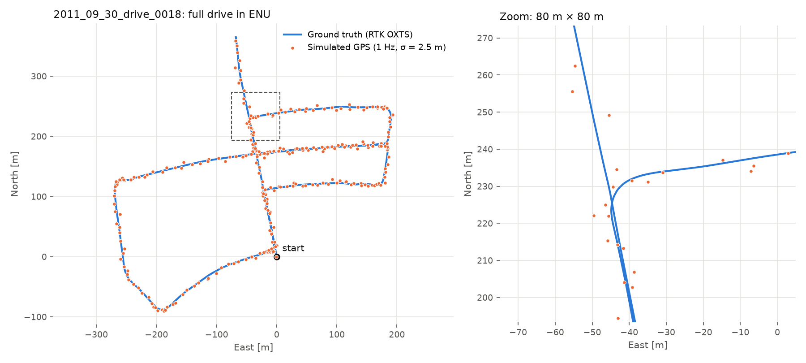

# NavFusion

**GPS/IMU vehicle state estimation on KITTI, and what to do when GPS disappears.**

[](LICENSE)


> 🚧 **Work in progress.** Sections marked *TBD* are filled in as each stage lands.

## Status
- [x] Project scaffold, KITTI OXTS downloader (~40 MB via HTTP range requests instead of ~91 GB)
- [x] OXTS loader, WGS84 → ENU transform, simulated 1 Hz GPS and MEMS IMU
- [ ] Dead reckoning baseline
- [ ] 8-state EKF with bias estimation and non-holonomic constraint
- [ ] GPS outage simulation
- [ ] LSTM velocity pseudo-measurement (training notebook + neural EKF)
- [ ] Evaluation (ATE / RPE / yaw error over 2 test drives × 2 outage patterns × 5 seeds)
- [ ] Figures, Streamlit dashboard, CI, Docker

Every production ADAS navigation stack has to keep localising through tunnels, urban canyons and
parking structures, where GNSS drops out and the filter has only a drifting MEMS IMU left. NavFusion
tells that story in three acts on real KITTI Raw drives:

1. **Dead reckoning.** Integrating a MEMS-grade IMU alone drifts within seconds.
2. **Classical EKF.** An 8-state GPS/IMU Extended Kalman Filter (position, velocity, yaw, and
   accelerometer/gyro biases), with a non-holonomic constraint, written from scratch in NumPy. It is
   accurate while GPS is available, but during outages it falls back to integrating the IMU.
3. **EKF + learned velocity measurement.** During GPS outages, a small LSTM reads the last 2 s of
   IMU data and predicts body-frame velocity *with its own uncertainty*. That prediction enters the
   EKF as a proper pseudo-measurement through the Kalman gain, so it never overwrites the state.
   The learned part enhances the classical filter and does not replace it.

The filters only ever see simulated sensors: a noisy 1 Hz consumer GPS (σ = 2.5 m) and a
MEMS-corrupted IMU. The RTK-grade OXTS data is used only for ground truth and training labels.

## Architecture
*TBD (Mermaid diagram)*

## Method
*TBD: EKF prediction/update equations, the 8-state model, NHC, the velocity pseudo-measurement*

## Training pipeline
*TBD*

## Results
*TBD: ATE / RPE / yaw error for all three methods × 2 test drives × 2 outage patterns × 5 seeds*

## Run locally

```bash
python3 -m venv .venv && . .venv/bin/activate
pip install -e ".[dev,train,viz,dashboard]"
bash data/download_data.sh      # OXTS GPS/IMU only (~40 MB)
```

## Tests
```bash
pytest          # unit tests run on synthetic data, so no KITTI download is needed
ruff check .
```

## Data
[KITTI Raw](https://www.cvlibs.net/datasets/kitti/raw_data.php) (Geiger et al., *Vision meets
Robotics: The KITTI Dataset*, IJRR 2013), licensed CC BY-NC-SA 3.0. Only the OXTS GPS/IMU streams of
8 drives are used: 5 for training, 1 for validation, 2 for testing.

The filters never see the RTK-grade OXTS data. They get a simulated 1 Hz GPS (σ = 2.5 m) and a
MEMS-corrupted IMU, both seeded so that every method sees identical noise:



```bash
python -m navfusion.data.inspect_drive   # integrity checks for all drives + this figure
```

## References
- M. Brossard, A. Barrau, S. Bonnabel, *AI-IMU Dead-Reckoning*, IEEE T-IV 2020.

## License
MIT (code). The KITTI data keeps its own license.
